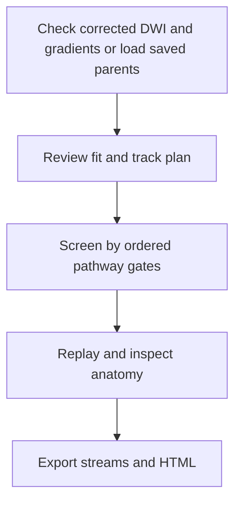

# NEO_MRI · CST/CRP tractography

[简体中文](README_CN.md) · [main](https://github.com/Du-YouLang/NEO_MRI/tree/main) · [Public data guide](https://github.com/Du-YouLang/NEO_MRI/blob/main/docs/PUBLIC_DATA.md)

Adds corrected-DWI fit and track plans, tensor and single-tissue CSD branches, ordered gate screening of parent streamlines, replay, export and HTML. The recommended starting exercise uses a generated tractogram.

This branch documents the earlier feature snapshot `tractography` (`e15f6cf`). For the integrated version, use main.

## Execution workflow



## Repository layout

```text
code/               Structural and lesion commands
bold/               Task BOLD back end
notebooks/          Jupyter entry points and available tutorials
tractography/       Tracking, screening and reporting
configs/examples/   Configuration templates
docs/               Operating guides
tests/              Synthetic checks
```

## Installation and input

Create and activate a Python 3.12 virtual environment from the checkout, then install the dependencies.

```sh
python -m venv .venv
# POSIX: source .venv/bin/activate
# PowerShell: .venv\Scripts\Activate.ps1
python -m pip install -r requirements-lock.txt
python -m pip install --no-deps .
python -m pip install --no-deps SimpleITK==2.5.6
python -m pytest
```

Provide corrected DWI with matching b-values and b-vectors, binary gates in DWI space or independently verified spatial transforms, and optional saved parent tracks. MRtrix3 is needed for native fitting and tracking. Copy a [configuration template](configs/examples/) and keep actual inputs and outputs outside the checkout.

```sh
python run_tractography.py demo --output /analysis/tractography_demo
python run_tractography.py report --results /analysis/tractography_demo/screened --output /analysis/tractography_demo/review.html
```

## Jupyter, tutorials and validation

Open [Tractography.ipynb](notebooks/Tractography.ipynb) or the [generated tutorial](notebooks/Tractography_Tutorial.ipynb). Install Jupyter with `python -m pip install jupyterlab ipywidgets` before opening a notebook. [Tractography guide](docs/TRACTOGRAPHY.md).

Synthetic and saved-streamline replay are covered. Verify anatomical landmarks and pull directions for real cross-template atlas mapping. Native MRtrix tracking needs real-environment qualification. HCP supplies healthy anatomy, diffusion and motor-task examples. OpenNeuro supplies BIDS task and ARC stroke examples. See the linked public data guide for the import steps.

## Acknowledgments

- Tournier, J.-D., Smith, R., Raffelt, D., Tabbara, R., Dhollander, T., Pietsch, M., Christiaens, D., Jeurissen, B., Yeh, C.-H., & Connelly, A. (2019). MRtrix3: A fast, flexible and open software framework for medical image processing and visualisation. *NeuroImage, 202*, 116137. [DOI](https://doi.org/10.1016/j.neuroimage.2019.116137) · [MRtrix3 source](https://github.com/MRtrix3/mrtrix3)
- Mayka, M. A., Corcos, D. M., Leurgans, S. E., & Vaillancourt, D. E. (2006). Three-dimensional locations and boundaries of motor and premotor cortices as defined by functional brain imaging: A meta-analysis. *NeuroImage, 31*(4), 1453–1474. [DOI](https://doi.org/10.1016/j.neuroimage.2006.02.004) · [HMAT](https://github.com/LRNLabUF/HMAT)
- Warrington, S., Bryant, K. L., Khrapitchev, A. A., Sallet, J., Charquero-Ballester, M., Douaud, G., Jbabdi, S., Mars, R. B., & Sotiropoulos, S. N. (2020). XTRACT—Standardised protocols for automated tractography in the human and macaque brain. *NeuroImage, 217*, 116923. [DOI](https://doi.org/10.1016/j.neuroimage.2020.116923)
- Tang, Y., Sun, W., Toga, A. W., Ringman, J. M., & Shi, Y. (2018). A probabilistic atlas of human brainstem pathways based on connectome imaging data. *NeuroImage, 169*, 227–239. [DOI](https://doi.org/10.1016/j.neuroimage.2017.12.042) · [Brainstem atlas](https://www.nitrc.org/frs/download.php/10255/Brainstem23BundleAtlas.zip)

See the complete APA references, data and upstream repository credits in [Acknowledgments](https://github.com/Du-YouLang/NEO_MRI/blob/main/docs/ACKNOWLEDGMENTS.md). [NOTICE](NOTICE.md)
