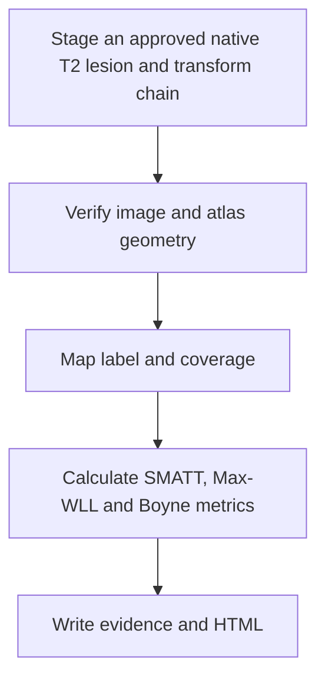

# NEO_MRI · SMATT, HCPA and Boyne lesion load

[简体中文](README_CN.md) · [main](https://github.com/Du-YouLang/NEO_MRI/tree/main) · [Public data guide](https://github.com/Du-YouLang/NEO_MRI/blob/main/docs/PUBLIC_DATA.md)

Adds atlas-based overlap and lesion coverage. Compute SMATT branch overlap, HCPA Max-WLL and exploratory Boyne 2025 method C against a reviewed spatial chain. T2 lesion propagation has a separate entry.

This branch documents the earlier feature snapshot `lesionload_SMATT_Boyne2025` (`09ca5b4`). For the integrated version, use main.

## Execution workflow



## Repository layout

```text
code/               Structural and lesion commands
bold/               Task BOLD back end
notebooks/          Jupyter entry points and available tutorials
tractography/       Tracking, screening and reporting
lesionload/         Lesion load and atlas manifest
configs/examples/   Configuration templates
docs/               Operating guides
tests/              Synthetic checks
```

## Installation and input

Create and activate a Python 3.12 virtual environment from the checkout, then install the dependencies.

```sh
python -m venv .venv
# POSIX: source .venv/bin/activate
# PowerShell: .venv\Scripts\Activate.ps1
python -m pip install -r requirements-lock.txt
python -m pip install --no-deps .
python -m pip install --no-deps SimpleITK==2.5.6
python -m pytest
```

Use the original lesion, its paired T2, verified transforms and atlas files from the pinned asset manifest. Check coverage and spatial direction before comparing metrics. Copy a [configuration template](configs/examples/) and keep actual inputs and outputs outside the checkout.

```sh
python run_lesionload.py demo --output /analysis/lesionload_demo
python run_lesionload.py run --config /analysis/lesionload.local.json --output /analysis/lesionload_case
```

## Jupyter, tutorials and validation

Open the [generated lesion-load tutorial](notebooks/Lesionload_Tutorial.ipynb). Install Jupyter with `python -m pip install jupyterlab ipywidgets` before opening a notebook. [Lesion load methods](docs/LESIONLOAD.md) and [T2 lesion propagation](docs/T2_LESION_PROPAGATION_V1.md).

Boyne method C remains exploratory. DLPFC is unresolved and the dependent FEFarea, Other and Unassigned channels need review. An archived chain's review hash records provenance. Confirm that it describes this visit and these transforms. HCP supplies healthy anatomy, diffusion and motor-task examples. OpenNeuro supplies BIDS task and ARC stroke examples. See the linked public data guide for the import steps.

## Acknowledgments

- Archer, D. B., Vaillancourt, D. E., & Coombes, S. A. (2018). A template and probabilistic atlas of the human sensorimotor tracts using diffusion MRI. *Cerebral Cortex, 28*(5), 1685–1699. [DOI](https://doi.org/10.1093/cercor/bhx066) · [SMATT download](https://lrnlab.org/a-template-and-probabilistic-atlas-of-the-human-sensorimotor-tracts-using-diffusion-mri/)
- Boyne, P., Williamson, B., Buclez, J., Cramer, S. C., & Lin, D. J. (2025). Probabilistic normative maps of the corticospinal and cortico-reticulospinal tracts in streamline and volumetric formats. *Journal of Neuroscience Methods, 423*, 110549. [DOI](https://doi.org/10.1016/j.jneumeth.2025.110549) · [OSF assets and scripts](https://doi.org/10.17605/OSF.IO/Q3GW7)
- Williamson, B. J., Behymer, T., Schwarz, A., Vagal, A., Winstein, C. J., Borich, M. R., Hanlon, C., Dimyan, M., Conforto, A. B., Piras, F., Vecchio, D., Hordacre, B., Boyd, L. A., Ferris, J. K., Cassidy, J. M., Thomopoulos, S. I., Jahanshad, N., Thompson, P. M., Khan, M., … Cramer, S. C. (2026). Optimizing the approach to calculating CST lesion load in ischemic stroke patients for understanding motor outcomes. *Neurorehabilitation and Neural Repair, 40*(6), 448–460. [DOI](https://doi.org/10.1177/15459683261417241) · [pyLesionLoad reference assets](https://github.com/willi3by/pyLesionLoad/tree/a4563f88bf310f4b2fb139d507061030de2328c5)

See the complete APA references, data and upstream repository credits in [Acknowledgments](https://github.com/Du-YouLang/NEO_MRI/blob/main/docs/ACKNOWLEDGMENTS.md). [NOTICE](NOTICE.md)
