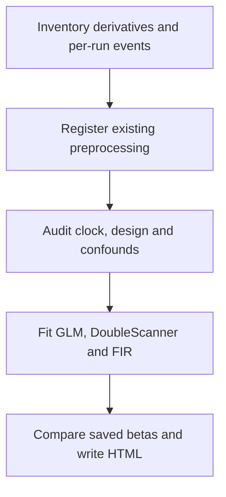

# NEO_MRI · Static and dynamic task fMRI

[简体中文](README_CN.md) · [main](https://github.com/Du-YouLang/NEO_MRI/tree/main) · [Public data guide](https://github.com/Du-YouLang/NEO_MRI/blob/main/docs/PUBLIC_DATA.md)

Adds task BOLD registration, design checks, static GLM with temporal derivatives, task-informed DoubleScanner and FIR sensitivity. Fit each acquisition independently. Eligible repeated runs can be combined by static fixed effects. Cross-task saved-beta comparisons are descriptive.

This branch documents the earlier feature snapshot `fMRI-static_and_dynamic` (`30ea412`). For the integrated version, use main.

## Execution workflow



## Repository layout

```text
code/               Structural and lesion commands
bold/               Task BOLD back end
notebooks/          Jupyter entry points and available tutorials
configs/examples/   Configuration templates
docs/               Operating guides
tests/              Synthetic checks
```

## Installation and input

Create and activate a Python 3.12 virtual environment from the checkout, then install the dependencies.

```sh
python -m venv .venv
# POSIX: source .venv/bin/activate
# PowerShell: .venv\Scripts\Activate.ps1
python -m pip install -r requirements-lock.txt
python -m pip install --no-deps .
python -m pip install --no-deps SimpleITK==2.5.6
python -m pytest
```

Supply registered fMRIPrep outputs with NIfTI, masks, confounds, metadata, completion evidence and per-run event TSV. The preprocess stage registers completed outputs. Review timing before fitting. Copy a [configuration template](configs/examples/) and keep actual inputs and outputs outside the checkout.

```sh
python run_bold.py inventory --config /analysis/task.local.json
python run_bold.py preprocess --config /analysis/task.local.json
python run_bold.py audit --config /analysis/task.local.json
```

## Jupyter, tutorials and validation

Open [Task_BOLD.ipynb](notebooks/Task_BOLD.ipynb). The [runnable generated tutorial on main](https://github.com/Du-YouLang/NEO_MRI/blob/main/notebooks/Task_BOLD_Tutorial.ipynb) uses the newer checkout. Install Jupyter with `python -m pip install jupyterlab ipywidgets` before opening a notebook. [BOLD operation and methods](docs/BOLD_AB.md).

Dynamic map B is exploratory. Validate saved map affines separately when reproducing this older snapshot. New BOLD changes and code review are on main. HCP supplies healthy anatomy, diffusion and motor-task examples. OpenNeuro supplies BIDS task and ARC stroke examples. See the linked public data guide for the import steps.

## Acknowledgments

- Esteban, O., Markiewicz, C. J., Blair, R. W., Moodie, C. A., Isik, A. I., Erramuzpe, A., Kent, J. D., Goncalves, M., DuPre, E., Snyder, M., Oya, H., Ghosh, S. S., Wright, J., Durnez, J., Poldrack, R. A., & Gorgolewski, K. J. (2019). fMRIPrep: A robust preprocessing pipeline for functional MRI. *Nature Methods, 16*(1), 111–116. [DOI](https://doi.org/10.1038/s41592-018-0235-4) · [fMRIPrep source](https://github.com/nipreps/fmriprep)
- Friston, K. J., Fletcher, P., Josephs, O., Holmes, A., Rugg, M. D., & Turner, R. (1998). Event-related fMRI: Characterizing differential responses. *NeuroImage, 7*(1), 30–40. [DOI](https://doi.org/10.1006/nimg.1997.0306) · [SPM model documentation](https://www.fil.ion.ucl.ac.uk/spm/docs/manual/fmri_spec/fmri_spec/)
- Benjamini, Y., & Yekutieli, D. (2001). The control of the false discovery rate in multiple testing under dependency. *The Annals of Statistics, 29*(4), 1165–1188. [DOI](https://doi.org/10.1214/aos/1013699998)

See the complete APA references, data and upstream repository credits in [Acknowledgments](https://github.com/Du-YouLang/NEO_MRI/blob/main/docs/ACKNOWLEDGMENTS.md). [NOTICE](NOTICE.md)
