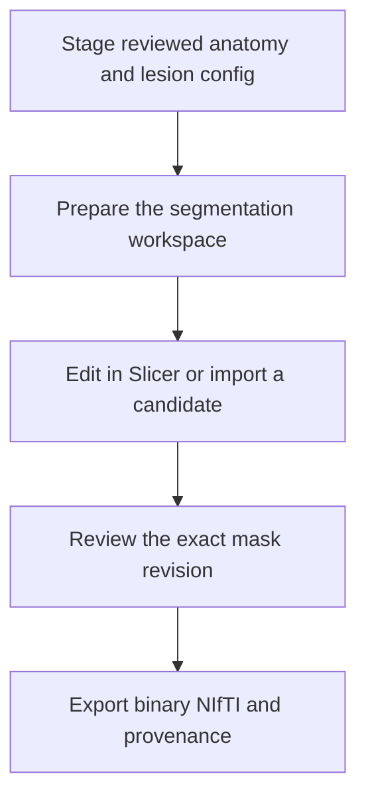

# NEO_MRI · Structural lesion interface

[简体中文](README_CN.md) · [main](https://github.com/Du-YouLang/NEO_MRI/tree/main) · [Public data guide](https://github.com/Du-YouLang/NEO_MRI/blob/main/docs/PUBLIC_DATA.md)

Adds a standalone lesion interface to the structural tools. Prepare reviewed backgrounds, edit in 3D Slicer or import an external SynthStroke candidate, record the review and export a versioned binary NIfTI mask.

This branch documents the earlier feature snapshot `feat/lesion-interface-structural` (`c2e28b1`). For the integrated version, use main.

## Execution workflow



## Repository layout

```text
code/               Structural and lesion commands
configs/examples/   Configuration templates
docs/               Operating guides
tests/              Synthetic checks
```

## Installation and input

Create and activate a Python 3.12 virtual environment from the checkout, then install the dependencies.

```sh
python -m venv .venv
# POSIX: source .venv/bin/activate
# PowerShell: .venv\Scripts\Activate.ps1
python -m pip install -r requirements-lock.txt
python -m pip install --no-deps .
python -m pip install --no-deps SimpleITK==2.5.6
python -m pytest
```

Use the reviewed native T1 and any existing registered T2/FLAIR from the same visit. Check affine, laterality and label values. Install Slicer or an authorized external SynthStroke environment separately. Copy a [configuration template](configs/examples/) and keep actual inputs and outputs outside the checkout.

```sh
neo-mri-lesion prepare --root /analysis --config lesion.local.json
neo-mri-lesion edit --root /analysis --config lesion.local.json --dry-run
neo-mri-lesion status --root /analysis --config lesion.local.json
```

## Jupyter, tutorials and validation

Use the CLI and the Slicer guide. The synthetic walkthrough is in the Slicer guide. [Lesion interface](docs/LESION.md), [Slicer guide](docs/SLICER_GUIDE.md), [SynthStroke](docs/SYNTHSTROKE.md).

An external candidate still needs review. The lesion interface does not launch another structural registration. HCP supplies healthy anatomy, diffusion and motor-task examples. OpenNeuro supplies BIDS task and ARC stroke examples. See the linked public data guide for the import steps.

## Acknowledgments

- Fedorov, A., Beichel, R., Kalpathy-Cramer, J., Finet, J., Fillion-Robin, J.-C., Pujol, S., Bauer, C., Jennings, D., Fennessy, F., Sonka, M., Buatti, J., Aylward, S., Miller, J. V., Pieper, S., & Kikinis, R. (2012). 3D Slicer as an image computing platform for the Quantitative Imaging Network. *Magnetic Resonance Imaging, 30*(9), 1323–1341. [DOI](https://doi.org/10.1016/j.mri.2012.05.001) · [Slicer source](https://github.com/Slicer/Slicer)
- Chalcroft, L., Pappas, I., Price, C. J., & Ashburner, J. (2025). Synthetic data for robust stroke segmentation. *Machine Learning for Biomedical Imaging, 3*, 317–346. [DOI](https://doi.org/10.59275/j.melba.2025-f3g6) · [SynthStroke source](https://github.com/liamchalcroft/SynthStroke)

See the complete APA references, data and upstream repository credits in [Acknowledgments](https://github.com/Du-YouLang/NEO_MRI/blob/main/docs/ACKNOWLEDGMENTS.md). [NOTICE](NOTICE.md)
