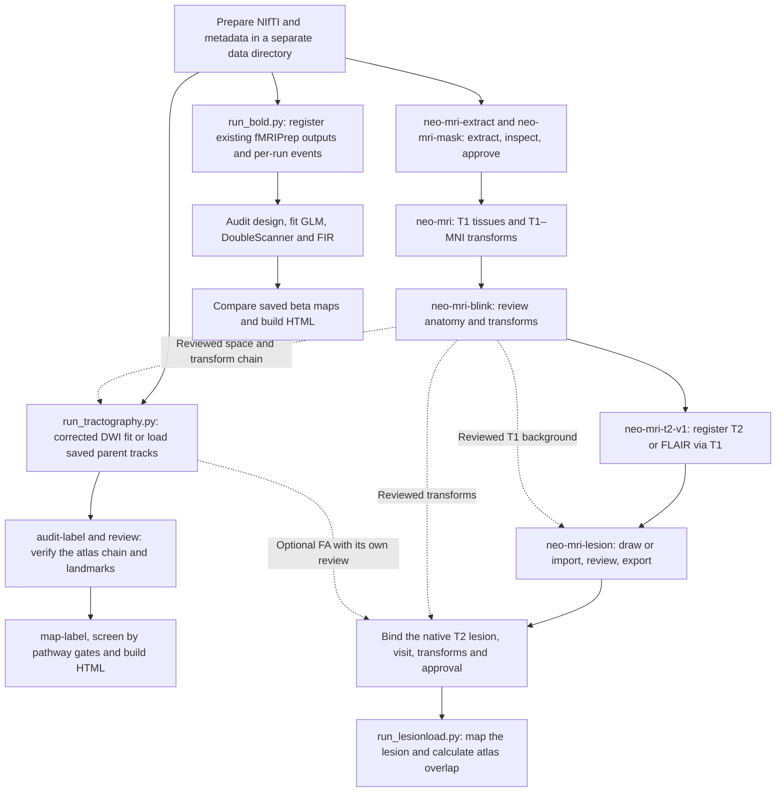

# NEO_MRI

[简体中文](README_CN.md) · [Public data guide](docs/PUBLIC_DATA.md) · [Spatial input review](docs/SPATIAL_INPUT_REVIEW.md) · [Code audit](docs/REPOSITORY_AUDIT.md)

NEO_MRI is a research toolkit for studying structural injury, task-evoked activity and motor pathways after stroke. It gives each analysis its own entry point and saves the inputs, spatial transforms, decisions and results needed for review.

## What you can run

| Workflow | Entry point | What it produces |
| --- | --- | --- |
| T1 anatomy | `neo-mri-extract`, `neo-mri-mask`, `neo-mri`, `neo-mri-blink` | Brain extraction candidates and slice review, reviewed anatomical inputs, tissue maps and T1–MNI registration QC |
| T2/FLAIR | `neo-mri-t2-v1` | T2/FLAIR aligned to the approved T1 and mapped into MNI with a composed transform. HD-BET is the default brain domain and the T1-derived brain domain is an explicit option. |
| Lesion segmentation | `neo-mri-lesion`, `neo-mri-t2-lesion-v1` | 3D Slicer manual or external SynthStroke candidate, revision review, binary mask export and optional T2 lesion propagation |
| Task fMRI | `python run_bold.py` | Run-by-run design QC, static GLM with temporal derivatives, dynamic DoubleScanner, FIR sensitivity analysis and HTML. Supports eligible same-task fixed effects and descriptive saved-beta comparisons. |
| CST/CRP tractography | `python run_tractography.py` | DWI fitting/tracking plans, screening of parent streamlines, replay and HTML review |
| Lesion load | `python run_lesionload.py` | Atlas-based SMATT overlap, HCPA Max-WLL and exploratory Boyne method C, plus report and provenance |

## Execution workflow



## Repository layout

```text
code/               T1, T2, lesion review and registration tools
bold/               Task BOLD design, models, comparisons and report
tractography/       DWI fit, tracking, gates, replay and report
lesionload/         Atlas manifest, overlap calculations and report
configs/examples/   Copyable JSON templates
notebooks/          Guided runs and tutorials
docs/               Operating guides, public data and citations
tests/              Synthetic regressions and wheel checks
.github/workflows/  CPU continuous integration
```

## Install and prepare a case

Use Python 3.12. From the repository root, activate a fresh virtual environment and install the pinned Python stack.

```sh
python -m venv .venv
# POSIX: source .venv/bin/activate
# PowerShell: .venv\Scripts\Activate.ps1
python -m pip install -r requirements-lock.txt
python -m pip install --no-deps .
python -m pip install --no-deps SimpleITK==2.5.6
python -m pip install jupyterlab ipywidgets
python -m pytest
python -m jupyterlab
```

The wheel installs structural and lesion commands. Use the repository checkout for BOLD, tractography and lesion load. Prepare HD-BET, optional SynthStrip and ANTs extraction, fMRIPrep 25.2.7 and its local FreeSurfer licence where required. MRtrix3 is required for native tracking. Models, templates, atlases and container images have their own distribution terms.

1. **Prepare local inputs.** Convert scanner exports outside this repository. Keep original files, acquisition JSON, task events and diffusion gradients together by subject and session. Check the NIfTI affine, voxel size, orientation and phase-encoding metadata before staging the inputs.
2. **Copy a configuration.** Start from [`configs/examples/`](configs/examples/). Fill in paths, input identity and output directory. Use absolute paths for the standalone T2 and T2 lesion commands. Keep local configs and reports outside the checkout.
3. **Run the first check.** For T1 use `neo-mri-extract plan --config <extraction.json>`, then review the candidate before `neo-mri t1-plan --config <T1.json>`. For T2 use `neo-mri-t2-v1 plan --config <T2.json>` with the reviewed T1 chain. For BOLD start at `inventory`. For diffusion start at `fit-plan` or replay a reviewed parent tractogram.
4. **Review before reuse.** Check slices and overlays, the actual transform direction and grid, design timing, and downstream reports as applicable. For Gen6 atlas mapping, the physical point lookup follows DWI → individual T1 → MNI2009c → Gen6, followed by one label interpolation. For new real-data CST mapping, streamline screening or lesion-load runs, use the [spatial input review guide](docs/SPATIAL_INPUT_REVIEW.md) to bind the visit and actual inputs to the approval. Optional FA requires its own evidence.

## Jupyter and tutorials

| Purpose | Step-by-step entry | Tutorial or operating guide |
| --- | --- | --- |
| T1 and T2/FLAIR | Structural CLI commands | [T1 review](docs/T1_MASK_REVIEW.md), [T2 stable workflow](docs/T2_STABLE_V1.md) |
| Lesion segmentation | Lesion CLI commands | [Manual Slicer guide](docs/SLICER_GUIDE.md), [SynthStroke interface](docs/SYNTHSTROKE.md) |
| Task fMRI | [Task BOLD](notebooks/Task_BOLD.ipynb) | [Runnable synthetic tutorial](notebooks/Task_BOLD_Tutorial.ipynb), [BOLD methods](docs/BOLD_AB.md) |
| DWI and CST/CRP | [Tractography](notebooks/Tractography.ipynb) | [Runnable synthetic tutorial](notebooks/Tractography_Tutorial.ipynb), [tractography guide](docs/TRACTOGRAPHY.md) |
| Lesion load | `run_lesionload.py` | [Runnable synthetic tutorial](notebooks/Lesionload_Tutorial.ipynb), [lesion load guide](docs/LESIONLOAD.md) |

Launch notebooks from the repository root with the environment above. They invoke the same back ends as the CLI. Structural workflows currently use the CLI with HTML QC. For public human data, the [data guide](docs/PUBLIC_DATA.md) gives HCP Young Adult routes for structural, diffusion and motor-task inputs, OpenNeuro for a BIDS task example, and ARC for genuine stroke lesions. The generated tutorials run locally without a human dataset or account.

## Branches and validation

`main` integrates the modules. The linked branches record the scope of earlier contributions. Use `main` for new work and review the diff and CPU checks in a PR. [Contribution guide](CONTRIBUTING.md)

| Branch | Scope |
| --- | --- |
| [`codex/structural-release-0.2.0rc1`](https://github.com/Du-YouLang/NEO_MRI/tree/codex/structural-release-0.2.0rc1) | T1 and T2 structural release candidate |
| [`feat/lesion-interface-structural`](https://github.com/Du-YouLang/NEO_MRI/tree/feat/lesion-interface-structural) | Lesion segmentation and review |
| [`fMRI-static_and_dynamic`](https://github.com/Du-YouLang/NEO_MRI/tree/fMRI-static_and_dynamic) | Static and dynamic task BOLD |
| [`tractography`](https://github.com/Du-YouLang/NEO_MRI/tree/tractography) | CST/CRP tracking and replay |
| [`lesionload_SMATT_Boyne2025`](https://github.com/Du-YouLang/NEO_MRI/tree/lesionload_SMATT_Boyne2025) | SMATT, HCPA and Boyne lesion load |

The [audit](docs/REPOSITORY_AUDIT.md) records synthetic coverage, archived-input replay and remaining qualification gaps. The public BOLD command registers existing fMRIPrep derivatives and does not start fMRIPrep. The native MRtrix3 launcher still needs qualification in a real MRtrix3 environment. Research use only. See [NOTICE](NOTICE.md) for the team's code provenance and pending licensing decision.

For actual anatomy runs, record which mask fMRIPrep used and inspect the T1–MNI anatomy before reusing the transforms. The portable T1 container launcher has synthetic planning and installation coverage. See [T1 validation](docs/T1_REVIEW_VALIDATION.md) and the [structural release scope](docs/RELEASE_SCOPE.md).

## Acknowledgments

We thank all the participants, investigators and software teams behind the external tools and data. The [APA references and upstream repository credits](docs/ACKNOWLEDGMENTS.md) cover anatomy, lesion segmentation, task fMRI, diffusion, atlas assets and public examples.

- Isensee, F., Schell, M., Pflueger, I., Brugnara, G., Bonekamp, D., Neuberger, U., Wick, A., Schlemmer, H.-P., Heiland, S., Wick, W., Bendszus, M., Maier-Hein, K. H., & Kickingereder, P. (2019). Automated brain extraction of multisequence MRI using artificial neural networks. *Human Brain Mapping, 40*(17), 4952–4964. [DOI](https://doi.org/10.1002/hbm.24750) · [HD-BET source](https://github.com/MIC-DKFZ/HD-BET)
- Esteban, O., Markiewicz, C. J., Blair, R. W., Moodie, C. A., Isik, A. I., Erramuzpe, A., Kent, J. D., Goncalves, M., DuPre, E., Snyder, M., Oya, H., Ghosh, S. S., Wright, J., Durnez, J., Poldrack, R. A., & Gorgolewski, K. J. (2019). fMRIPrep: A robust preprocessing pipeline for functional MRI. *Nature Methods, 16*(1), 111–116. [DOI](https://doi.org/10.1038/s41592-018-0235-4) · [fMRIPrep source](https://github.com/nipreps/fmriprep)
- Tournier, J.-D., Smith, R., Raffelt, D., Tabbara, R., Dhollander, T., Pietsch, M., Christiaens, D., Jeurissen, B., Yeh, C.-H., & Connelly, A. (2019). MRtrix3: A fast, flexible and open software framework for medical image processing and visualisation. *NeuroImage, 202*, 116137. [DOI](https://doi.org/10.1016/j.neuroimage.2019.116137) · [MRtrix3 source](https://github.com/MRtrix3/mrtrix3)
- Gibson, M., Newman-Norlund, R., Bonilha, L., Fridriksson, J., Hickok, G., Hillis, A. E., den Ouden, D.-B., & Rorden, C. (2024). The Aphasia Recovery Cohort, an open-source chronic stroke repository. *Scientific Data, 11*, 981. [DOI](https://doi.org/10.1038/s41597-024-03819-7) · [OpenNeuro dataset v1.0.2](https://doi.org/10.18112/openneuro.ds004884.v1.0.2)
- Van Essen, D. C., Smith, S. M., Barch, D. M., Behrens, T. E. J., Yacoub, E., & Uğurbil, K. (2013). The WU-Minn Human Connectome Project: An overview. *NeuroImage, 80*, 62–79. [DOI](https://doi.org/10.1016/j.neuroimage.2013.05.041) · [HCP data-use terms and required acknowledgment](https://www.humanconnectome.org/study/hcp-young-adult/data-use-terms)
