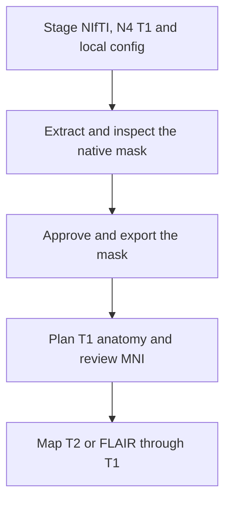

# NEO_MRI · T1/T2 structural release candidate

[简体中文](README_CN.md) · [main](https://github.com/Du-YouLang/NEO_MRI/tree/main) · [Public data guide](https://github.com/Du-YouLang/NEO_MRI/blob/main/docs/PUBLIC_DATA.md)

Review native T1 brain extraction, plan anat-only fMRIPrep, inspect T1–MNI alignment and align same-session T2/FLAIR through approved T1 transforms. HD-BET CPU is the default candidate. SynthStrip and the two ANTs template choices are explicit alternatives. The T2 route preserves native and N4 comparisons.

This branch documents the earlier feature snapshot `codex/structural-release-0.2.0rc1` (`1017c09`). For the integrated version, use main.

## Execution workflow



## Repository layout

```text
code/               Structural commands
configs/examples/   Configuration templates
docs/               Operating guides
tests/              Synthetic checks
```

## Installation and input

Create and activate a Python 3.12 virtual environment from the checkout, then install the dependencies.

```sh
python -m venv .venv
# POSIX: source .venv/bin/activate
# PowerShell: .venv\Scripts\Activate.ps1
python -m pip install -r requirements-lock.txt
python -m pip install --no-deps .
python -m pip install --no-deps SimpleITK==2.5.6
python -m pytest
```

Prepare a staged BIDS project, a full-head N4-corrected T1w, and T2w/FLAIR if available. Use absolute paths for the T2 configuration. Supply the reviewed mask and T1 transform chain before running downstream commands. Copy a [configuration template](configs/examples/) and keep actual inputs and outputs outside the checkout.

```sh
neo-mri-extract policy
neo-mri-extract plan --config /analysis/extraction.local.json
neo-mri t1-plan --config /analysis/T1.local.json
neo-mri-t2-v1 plan --config /analysis/T2.local.json
```

## Jupyter, tutorials and validation

Use the CLI and HTML review for this branch. [T1 review](docs/T1_MASK_REVIEW.md) and [T2 stable workflow](docs/T2_STABLE_V1.md).

The general fMRIPrep launcher is a release candidate. The historical release documentation records the scope of image-based qualification. HCP supplies healthy anatomy, diffusion and motor-task examples. OpenNeuro supplies BIDS task and ARC stroke examples. See the linked public data guide for the import steps.

## Acknowledgments

- Isensee, F., Schell, M., Pflueger, I., Brugnara, G., Bonekamp, D., Neuberger, U., Wick, A., Schlemmer, H.-P., Heiland, S., Wick, W., Bendszus, M., Maier-Hein, K. H., & Kickingereder, P. (2019). Automated brain extraction of multisequence MRI using artificial neural networks. *Human Brain Mapping, 40*(17), 4952–4964. [DOI](https://doi.org/10.1002/hbm.24750) · [HD-BET source](https://github.com/MIC-DKFZ/HD-BET)
- Avants, B. B., Tustison, N. J., Song, G., Cook, P. A., Klein, A., & Gee, J. C. (2011). A reproducible evaluation of ANTs similarity metric performance in brain image registration. *NeuroImage, 54*(3), 2033–2044. [DOI](https://doi.org/10.1016/j.neuroimage.2010.09.025) · [ANTs source](https://github.com/ANTsX/ANTs)

See the complete APA references, data and upstream repository credits in [Acknowledgments](https://github.com/Du-YouLang/NEO_MRI/blob/main/docs/ACKNOWLEDGMENTS.md). [NOTICE](NOTICE.md)
