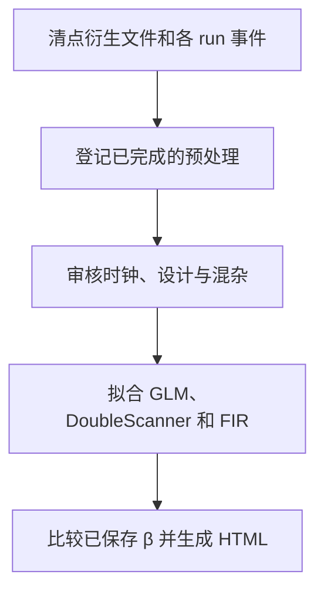

# NEO_MRI · 任务态 fMRI 静态与动态分析

[English](README.md) · [main](https://github.com/Du-YouLang/NEO_MRI/tree/main) · [公开数据指南](https://github.com/Du-YouLang/NEO_MRI/blob/main/docs/PUBLIC_DATA.md)

增加任务 BOLD 登记、设计检查、静态 GLM＋时间导数、任务引导的 DoubleScanner 和 FIR 敏感性。逐采集拟合，符合条件的同任务 run 可做静态固定效应，跨任务 β 比较用于描述。

本分支保存历史功能提交 `fMRI-static_and_dynamic` (`30ea412`). 当前组合版本见 main。

## 执行流程



## 仓库结构

```text
code/               结构像和病灶命令
bold/               任务 BOLD
notebooks/          Jupyter 入口与可用教程
configs/examples/   配置模板
docs/               操作指南
tests/              合成测试
```

## 安装与数据接入

在仓库根目录用 Python 3.12 建立并激活虚拟环境，然后安装依赖。

```sh
python -m venv .venv
# POSIX: source .venv/bin/activate
# PowerShell: .venv\Scripts\Activate.ps1
python -m pip install -r requirements-lock.txt
python -m pip install --no-deps .
python -m pip install --no-deps SimpleITK==2.5.6
python -m pytest
```

提供已有 fMRIPrep NIfTI、掩膜、混杂、元数据、完成证据及每条 run 的事件 TSV。preprocess 只登记已有衍生文件。审核时序后再拟合。 配置从[示例目录](configs/examples/)复制，文件和产出放在仓库外。

```sh
python run_bold.py inventory --config /analysis/task.local.json
python run_bold.py preprocess --config /analysis/task.local.json
python run_bold.py audit --config /analysis/task.local.json
```

## Jupyter、教程和验证

打开[任务 BOLD](notebooks/Task_BOLD.ipynb)。[可运行合成教程](https://github.com/Du-YouLang/NEO_MRI/blob/main/notebooks/Task_BOLD_Tutorial.ipynb)在 main。 启动前可用 `python -m pip install jupyterlab ipywidgets` 安装 Jupyter。 [BOLD 操作及方法](docs/BOLD_AB.md).

动态 B 图用于探索。复现本历史提交时应另核对已保存统计图仿射，当前 BOLD 维护在 main。 公开人类数据可从 HCP（健康结构、扩散和运动任务）或 OpenNeuro（BIDS 任务和 ARC 卒中标注）取得，接入方式见上方数据指南。

## 致谢

- Esteban, O., Markiewicz, C. J., Blair, R. W., Moodie, C. A., Isik, A. I., Erramuzpe, A., Kent, J. D., Goncalves, M., DuPre, E., Snyder, M., Oya, H., Ghosh, S. S., Wright, J., Durnez, J., Poldrack, R. A., & Gorgolewski, K. J. (2019). fMRIPrep: A robust preprocessing pipeline for functional MRI. *Nature Methods, 16*(1), 111–116. [DOI](https://doi.org/10.1038/s41592-018-0235-4) · [fMRIPrep source](https://github.com/nipreps/fmriprep)
- Friston, K. J., Fletcher, P., Josephs, O., Holmes, A., Rugg, M. D., & Turner, R. (1998). Event-related fMRI: Characterizing differential responses. *NeuroImage, 7*(1), 30–40. [DOI](https://doi.org/10.1006/nimg.1997.0306) · [SPM model documentation](https://www.fil.ion.ucl.ac.uk/spm/docs/manual/fmri_spec/fmri_spec/)
- Benjamini, Y., & Yekutieli, D. (2001). The control of the false discovery rate in multiple testing under dependency. *The Annals of Statistics, 29*(4), 1165–1188. [DOI](https://doi.org/10.1214/aos/1013699998)

完整 APA 文献、数据和上游代码见 [致谢目录](https://github.com/Du-YouLang/NEO_MRI/blob/main/docs/ACKNOWLEDGMENTS.md)。 [NOTICE](NOTICE.md)
