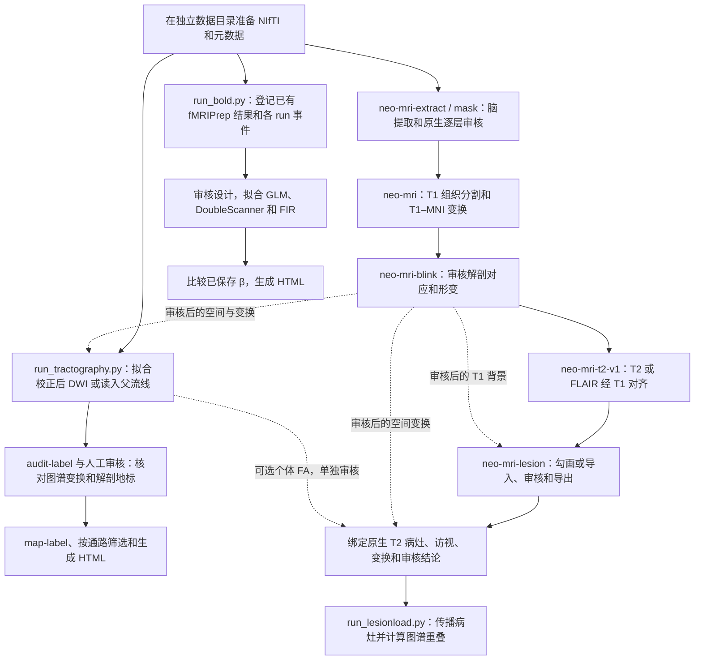

# NEO_MRI

[English](README.md) · [公开数据接入](docs/PUBLIC_DATA.md) · [空间输入审核](docs/SPATIAL_INPUT_REVIEW.md) · [代码审查](docs/REPOSITORY_AUDIT.md)

NEO_MRI 用于卒中研究，帮助团队检查结构损伤、任务诱发活动与运动通路。各分析入口分开，输入、变换、审核结论和结果按受试者与访视留存，方便同事复核。

## 能做什么

| 模块 | 入口 | 产出 |
| --- | --- | --- |
| T1 | `neo-mri-extract`、`neo-mri-mask`、`neo-mri`、`neo-mri-blink` | 脑提取候选、逐层审核、组织分割、T1–MNI 正逆变换及配准质控 |
| T2/FLAIR | `neo-mri-t2-v1` | 配准到已审核 T1，组合变换后一次重采样到 MNI。默认 HD-BET 脑域，T1 派生脑域可选。 |
| 病灶 | `neo-mri-lesion`、`neo-mri-t2-lesion-v1` | 3D Slicer 人工勾画或外部 SynthStroke 候选、版本审核、二值掩膜及 T2 病灶传播 |
| 任务 fMRI | `python run_bold.py` | 按 run 审核设计，拟合静态 GLM＋时间导数、动态 DoubleScanner、FIR 敏感性，支持合格的同任务固定效应和已存 β 描述性比较 |
| CST/CRP | `python run_tractography.py` | 扩散拟合和追踪计划、父流线筛选与回放、HTML |
| 病灶负荷 | `python run_lesionload.py` | SMATT 重叠、HCPA Max-WLL、探索性 Boyne 方法 C，以及审核报告 |

## 处理流程



## 仓库目录

```text
code/               T1、T2、病灶和配准审核
bold/               任务 BOLD 设计、拟合、比较和报告
tractography/       DWI 拟合、追踪、筛选、回放和报告
lesionload/         图谱资产清单、重叠计算和报告
configs/examples/   配置模板
notebooks/          分步入口与教程
docs/               操作指南、数据指南与文献
tests/              合成测试和安装包检查
.github/workflows/  CPU 自动测试
```

## 怎么开始

1. 用 Python 3.12 建立虚拟环境并激活。按[安装命令](README.md#install-and-prepare-a-case)安装锁定依赖、结构工具、SimpleITK 和 Jupyter。wheel 提供结构与病灶命令，BOLD、追踪与病灶负荷脚本从仓库检出目录使用。
2. 在仓库外准备 NIfTI/BIDS 和配套元数据。医院 DICOM 转换在外部完成。按同一受试者和访视整理结构像、BOLD、事件及 DWI 梯度，确认实际方向、体素和采样时钟。HD-BET、ANTs、SynthStrip、fMRIPrep、MRtrix3 和相应资产按所用路线单独准备。
3. 从 [`configs/examples/`](configs/examples/)复制配置，填写身份、路径和输出位置。独立 T2 和 T2 病灶命令建议使用绝对路径。结构像先跑 `plan`，任务 BOLD 先跑 `inventory`，扩散先看 `fit-plan` 或复用经过审核的父流线。按各指南完成阶段审核。
4. 打开自动生成的报告，核对真实影像与掩膜、变换方向、功能时序或追踪边界。Gen6 图谱按 DWI → 个体 T1 → MNI2009c → Gen6 回查物理坐标，标签只重采样一次。新做真实 CST 映射、流线筛选或病灶负荷时，按[空间输入审核指南](docs/SPATIAL_INPUT_REVIEW.md)绑定访视、实际输入和审核结论。启用 FA 时还需单独核对来源。质控回执、配置和结果留在个体访视目录。

## Jupyter 与操作教程

| 用途 | 分步入口 | 教程 |
| --- | --- | --- |
| T1、T2/FLAIR | 结构命令行 | [T1 审核](docs/T1_MASK_REVIEW.md)、[T2 稳定流程](docs/T2_STABLE_V1.md) |
| 病灶分割 | 病灶命令行 | [Slicer 指南](docs/SLICER_GUIDE.md)、[SynthStroke 接口](docs/SYNTHSTROKE.md) |
| 任务 fMRI | [分步处理](notebooks/Task_BOLD.ipynb) | [可运行合成教程](notebooks/Task_BOLD_Tutorial.ipynb)、[方法指南](docs/BOLD_AB.md) |
| 扩散与通路 | [分步处理](notebooks/Tractography.ipynb) | [可运行合成教程](notebooks/Tractography_Tutorial.ipynb)、[追踪指南](docs/TRACTOGRAPHY.md) |
| 病灶负荷 | `run_lesionload.py` | [可运行合成教程](notebooks/Lesionload_Tutorial.ipynb)、[病灶负荷指南](docs/LESIONLOAD.md) |

在仓库根目录启动 Jupyter，选择已安装依赖的 Python 内核。[公开数据指南](docs/PUBLIC_DATA.md)给出 HCP 健康结构、DWI 和运动任务，OpenNeuro BIDS 任务及 ARC 真实卒中病灶的接入路径。合成教程可离线运行。

## 分支与验证范围

[`main` 的分支索引](README.md#branches-and-validation)列出结构、病灶、任务 fMRI、追踪和病灶负荷五个历史模块分支。新改动从 `main` 开分支，按 [协作约定](CONTRIBUTING.md)审核差异后提 PR。

[代码审查](docs/REPOSITORY_AUDIT.md)记录了合成验证、已有数据重放和待完成的真实环境验收。BOLD 入口登记已经完成的 fMRIPrep 结果，MRtrix3 原生启动入口仍需真实环境验收。当前仅用于研究。[来源及许可状态](NOTICE.md)记录本仓库权属与许可进展。

实际跑 T1 时要核对 fMRIPrep 用了哪一份脑掩膜，并查看 T1–MNI 的解剖对应。通用容器启动器已有合成规划与安装验证。细节见 [T1 审核验证](docs/T1_REVIEW_VALIDATION.md)和[结构发布范围](docs/RELEASE_SCOPE.md)。

## 致谢

感谢外部工具和数据背后的研究参与者、研究者及软件团队。[APA 文献与上游代码仓库](docs/ACKNOWLEDGMENTS.md)按流程列出了引用和来源。

- Isensee, F., Schell, M., Pflueger, I., Brugnara, G., Bonekamp, D., Neuberger, U., Wick, A., Schlemmer, H.-P., Heiland, S., Wick, W., Bendszus, M., Maier-Hein, K. H., & Kickingereder, P. (2019). Automated brain extraction of multisequence MRI using artificial neural networks. *Human Brain Mapping, 40*(17), 4952–4964. [DOI](https://doi.org/10.1002/hbm.24750) · [HD-BET source](https://github.com/MIC-DKFZ/HD-BET)
- Esteban, O., Markiewicz, C. J., Blair, R. W., Moodie, C. A., Isik, A. I., Erramuzpe, A., Kent, J. D., Goncalves, M., DuPre, E., Snyder, M., Oya, H., Ghosh, S. S., Wright, J., Durnez, J., Poldrack, R. A., & Gorgolewski, K. J. (2019). fMRIPrep: A robust preprocessing pipeline for functional MRI. *Nature Methods, 16*(1), 111–116. [DOI](https://doi.org/10.1038/s41592-018-0235-4) · [fMRIPrep source](https://github.com/nipreps/fmriprep)
- Tournier, J.-D., Smith, R., Raffelt, D., Tabbara, R., Dhollander, T., Pietsch, M., Christiaens, D., Jeurissen, B., Yeh, C.-H., & Connelly, A. (2019). MRtrix3: A fast, flexible and open software framework for medical image processing and visualisation. *NeuroImage, 202*, 116137. [DOI](https://doi.org/10.1016/j.neuroimage.2019.116137) · [MRtrix3 source](https://github.com/MRtrix3/mrtrix3)
- Gibson, M., Newman-Norlund, R., Bonilha, L., Fridriksson, J., Hickok, G., Hillis, A. E., den Ouden, D.-B., & Rorden, C. (2024). The Aphasia Recovery Cohort, an open-source chronic stroke repository. *Scientific Data, 11*, 981. [DOI](https://doi.org/10.1038/s41597-024-03819-7) · [OpenNeuro dataset v1.0.2](https://doi.org/10.18112/openneuro.ds004884.v1.0.2)
- Van Essen, D. C., Smith, S. M., Barch, D. M., Behrens, T. E. J., Yacoub, E., & Uğurbil, K. (2013). The WU-Minn Human Connectome Project: An overview. *NeuroImage, 80*, 62–79. [DOI](https://doi.org/10.1016/j.neuroimage.2013.05.041) · [HCP data-use terms and required acknowledgment](https://www.humanconnectome.org/study/hcp-young-adult/data-use-terms)
