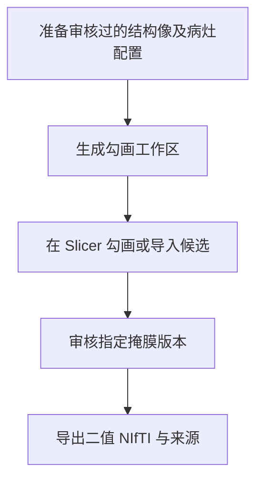

# NEO_MRI · 结构像病灶分割接口

[English](README.md) · [main](https://github.com/Du-YouLang/NEO_MRI/tree/main) · [公开数据指南](https://github.com/Du-YouLang/NEO_MRI/blob/main/docs/PUBLIC_DATA.md)

在结构工具上增加独立病灶入口。准备已审核背景，在 3D Slicer 勾画或导入外部 SynthStroke 候选，记录审核后导出有版本的二值 NIfTI。

本分支保存历史功能提交 `feat/lesion-interface-structural` (`c2e28b1`). 当前组合版本见 main。

## 执行流程



## 仓库结构

```text
code/               结构像和病灶命令
configs/examples/   配置模板
docs/               操作指南
tests/              合成测试
```

## 安装与数据接入

在仓库根目录用 Python 3.12 建立并激活虚拟环境，然后安装依赖。

```sh
python -m venv .venv
# POSIX: source .venv/bin/activate
# PowerShell: .venv\Scripts\Activate.ps1
python -m pip install -r requirements-lock.txt
python -m pip install --no-deps .
python -m pip install --no-deps SimpleITK==2.5.6
python -m pytest
```

使用同访视已审核 T1 及已有配准的 T2/FLAIR，核对仿射、左右和标签值。另行准备 Slicer 或获授权的 SynthStroke 环境。 配置从[示例目录](configs/examples/)复制，文件和产出放在仓库外。

```sh
neo-mri-lesion prepare --root /analysis --config lesion.local.json
neo-mri-lesion edit --root /analysis --config lesion.local.json --dry-run
neo-mri-lesion status --root /analysis --config lesion.local.json
```

## Jupyter、教程和验证

使用命令行和 Slicer 指南，指南内有合成演示。 [病灶接口](docs/LESION.md)、[Slicer 指南](docs/SLICER_GUIDE.md)、[SynthStroke](docs/SYNTHSTROKE.md).

外部候选仍需逐例审核，病灶接口复用已有结构配准。 公开人类数据可从 HCP（健康结构、扩散和运动任务）或 OpenNeuro（BIDS 任务和 ARC 卒中标注）取得，接入方式见上方数据指南。

## 致谢

- Fedorov, A., Beichel, R., Kalpathy-Cramer, J., Finet, J., Fillion-Robin, J.-C., Pujol, S., Bauer, C., Jennings, D., Fennessy, F., Sonka, M., Buatti, J., Aylward, S., Miller, J. V., Pieper, S., & Kikinis, R. (2012). 3D Slicer as an image computing platform for the Quantitative Imaging Network. *Magnetic Resonance Imaging, 30*(9), 1323–1341. [DOI](https://doi.org/10.1016/j.mri.2012.05.001) · [Slicer source](https://github.com/Slicer/Slicer)
- Chalcroft, L., Pappas, I., Price, C. J., & Ashburner, J. (2025). Synthetic data for robust stroke segmentation. *Machine Learning for Biomedical Imaging, 3*, 317–346. [DOI](https://doi.org/10.59275/j.melba.2025-f3g6) · [SynthStroke source](https://github.com/liamchalcroft/SynthStroke)

完整 APA 文献、数据和上游代码见 [致谢目录](https://github.com/Du-YouLang/NEO_MRI/blob/main/docs/ACKNOWLEDGMENTS.md)。 [NOTICE](NOTICE.md)
