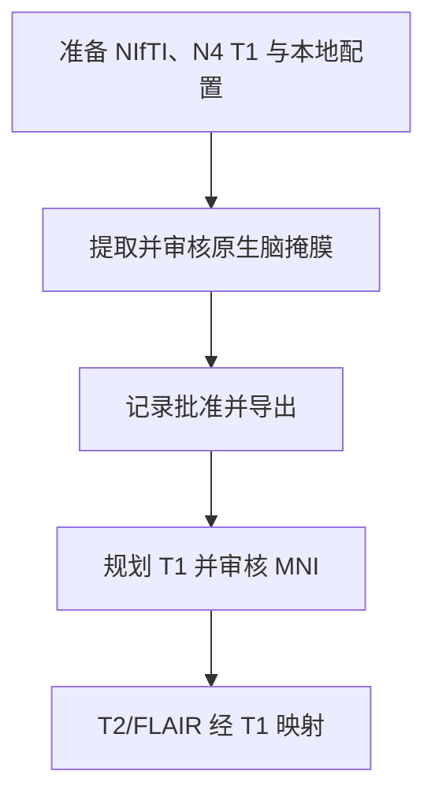

# NEO_MRI · T1/T2 结构发布候选

[English](README.md) · [main](https://github.com/Du-YouLang/NEO_MRI/tree/main) · [公开数据指南](https://github.com/Du-YouLang/NEO_MRI/blob/main/docs/PUBLIC_DATA.md)

用于逐层审核 T1 脑掩膜、规划 anat-only fMRIPrep、审核 T1–MNI 配准并经已审核 T1 对齐同访视 T2/FLAIR。HD-BET CPU 为默认候选，SynthStrip 与两个 ANTs 模板需明确选择。T2 路线保留原强度与 N4 对照。

本分支保存历史功能提交 `codex/structural-release-0.2.0rc1` (`1017c09`). 当前组合版本见 main。

## 执行流程



## 仓库结构

```text
code/               结构像命令
configs/examples/   配置模板
docs/               操作指南
tests/              合成测试
```

## 安装与数据接入

在仓库根目录用 Python 3.12 建立并激活虚拟环境，然后安装依赖。

```sh
python -m venv .venv
# POSIX: source .venv/bin/activate
# PowerShell: .venv\Scripts\Activate.ps1
python -m pip install -r requirements-lock.txt
python -m pip install --no-deps .
python -m pip install --no-deps SimpleITK==2.5.6
python -m pytest
```

准备 BIDS 项目、已做 N4 的全头 T1，以及可用的 T2/FLAIR。T2 配置使用绝对路径。向下游提供已审核掩膜及 T1 变换链。 配置从[示例目录](configs/examples/)复制，文件和产出放在仓库外。

```sh
neo-mri-extract policy
neo-mri-extract plan --config /analysis/extraction.local.json
neo-mri t1-plan --config /analysis/T1.local.json
neo-mri-t2-v1 plan --config /analysis/T2.local.json
```

## Jupyter、教程和验证

本分支使用命令行和 HTML 逐层审核。 [T1 审核](docs/T1_MASK_REVIEW.md)和 [T2 稳定流程](docs/T2_STABLE_V1.md).

通用 fMRIPrep 启动器仍为发布候选，真实影像验收范围见历史发布说明。 公开人类数据可从 HCP（健康结构、扩散和运动任务）或 OpenNeuro（BIDS 任务和 ARC 卒中标注）取得，接入方式见上方数据指南。

## 致谢

- Isensee, F., Schell, M., Pflueger, I., Brugnara, G., Bonekamp, D., Neuberger, U., Wick, A., Schlemmer, H.-P., Heiland, S., Wick, W., Bendszus, M., Maier-Hein, K. H., & Kickingereder, P. (2019). Automated brain extraction of multisequence MRI using artificial neural networks. *Human Brain Mapping, 40*(17), 4952–4964. [DOI](https://doi.org/10.1002/hbm.24750) · [HD-BET source](https://github.com/MIC-DKFZ/HD-BET)
- Avants, B. B., Tustison, N. J., Song, G., Cook, P. A., Klein, A., & Gee, J. C. (2011). A reproducible evaluation of ANTs similarity metric performance in brain image registration. *NeuroImage, 54*(3), 2033–2044. [DOI](https://doi.org/10.1016/j.neuroimage.2010.09.025) · [ANTs source](https://github.com/ANTsX/ANTs)

完整 APA 文献、数据和上游代码见 [致谢目录](https://github.com/Du-YouLang/NEO_MRI/blob/main/docs/ACKNOWLEDGMENTS.md)。 [NOTICE](NOTICE.md)
