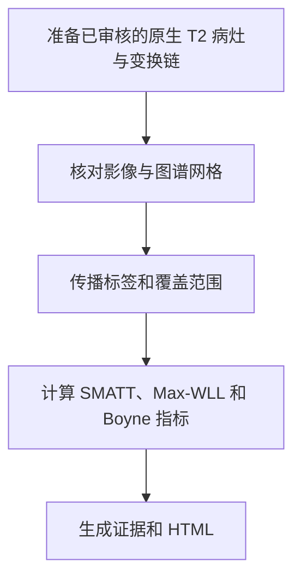

# NEO_MRI · SMATT、HCPA 与 Boyne 病灶负荷

[English](README.md) · [main](https://github.com/Du-YouLang/NEO_MRI/tree/main) · [公开数据指南](https://github.com/Du-YouLang/NEO_MRI/blob/main/docs/PUBLIC_DATA.md)

增加标准图谱的重叠和病灶覆盖计算，按已审核变换链计算 SMATT 分束重叠、HCPA Max-WLL 和探索性 Boyne 2025 方法 C，另有独立 T2 病灶传播入口。

本分支保存历史功能提交 `lesionload_SMATT_Boyne2025` (`09ca5b4`). 当前组合版本见 main。

## 执行流程



## 仓库结构

```text
code/               结构像和病灶命令
bold/               任务 BOLD
notebooks/          Jupyter 入口与可用教程
tractography/       追踪、筛选和报告
lesionload/         病灶负荷和图谱资产清单
configs/examples/   配置模板
docs/               操作指南
tests/              合成测试
```

## 安装与数据接入

在仓库根目录用 Python 3.12 建立并激活虚拟环境，然后安装依赖。

```sh
python -m venv .venv
# POSIX: source .venv/bin/activate
# PowerShell: .venv\Scripts\Activate.ps1
python -m pip install -r requirements-lock.txt
python -m pip install --no-deps .
python -m pip install --no-deps SimpleITK==2.5.6
python -m pytest
```

提供原生病灶、对应 T2、已经核对的变换和资产清单锁定的图谱。比较指标前检查有效覆盖范围和变换方向。 配置从[示例目录](configs/examples/)复制，文件和产出放在仓库外。

```sh
python run_lesionload.py demo --output /analysis/lesionload_demo
python run_lesionload.py run --config /analysis/lesionload.local.json --output /analysis/lesionload_case
```

## Jupyter、教程和验证

打开[病灶负荷合成教程](notebooks/Lesionload_Tutorial.ipynb)。 启动前可用 `python -m pip install jupyterlab ipywidgets` 安装 Jupyter。 [病灶负荷方法](docs/LESIONLOAD.md)和 [T2 病灶传播](docs/T2_LESION_PROPAGATION_V1.md).

Boyne 方法 C 属于探索。DLPFC 待解决，相关 FEFarea、Other、Unassigned 通道待复核。旧链审核文件的哈希用于记录，使用前核对其确实对应本访视及变换。 公开人类数据可从 HCP（健康结构、扩散和运动任务）或 OpenNeuro（BIDS 任务和 ARC 卒中标注）取得，接入方式见上方数据指南。

## 致谢

- Archer, D. B., Vaillancourt, D. E., & Coombes, S. A. (2018). A template and probabilistic atlas of the human sensorimotor tracts using diffusion MRI. *Cerebral Cortex, 28*(5), 1685–1699. [DOI](https://doi.org/10.1093/cercor/bhx066) · [SMATT download](https://lrnlab.org/a-template-and-probabilistic-atlas-of-the-human-sensorimotor-tracts-using-diffusion-mri/)
- Boyne, P., Williamson, B., Buclez, J., Cramer, S. C., & Lin, D. J. (2025). Probabilistic normative maps of the corticospinal and cortico-reticulospinal tracts in streamline and volumetric formats. *Journal of Neuroscience Methods, 423*, 110549. [DOI](https://doi.org/10.1016/j.jneumeth.2025.110549) · [OSF assets and scripts](https://doi.org/10.17605/OSF.IO/Q3GW7)
- Williamson, B. J., Behymer, T., Schwarz, A., Vagal, A., Winstein, C. J., Borich, M. R., Hanlon, C., Dimyan, M., Conforto, A. B., Piras, F., Vecchio, D., Hordacre, B., Boyd, L. A., Ferris, J. K., Cassidy, J. M., Thomopoulos, S. I., Jahanshad, N., Thompson, P. M., Khan, M., … Cramer, S. C. (2026). Optimizing the approach to calculating CST lesion load in ischemic stroke patients for understanding motor outcomes. *Neurorehabilitation and Neural Repair, 40*(6), 448–460. [DOI](https://doi.org/10.1177/15459683261417241) · [pyLesionLoad reference assets](https://github.com/willi3by/pyLesionLoad/tree/a4563f88bf310f4b2fb139d507061030de2328c5)

完整 APA 文献、数据和上游代码见 [致谢目录](https://github.com/Du-YouLang/NEO_MRI/blob/main/docs/ACKNOWLEDGMENTS.md)。 [NOTICE](NOTICE.md)
