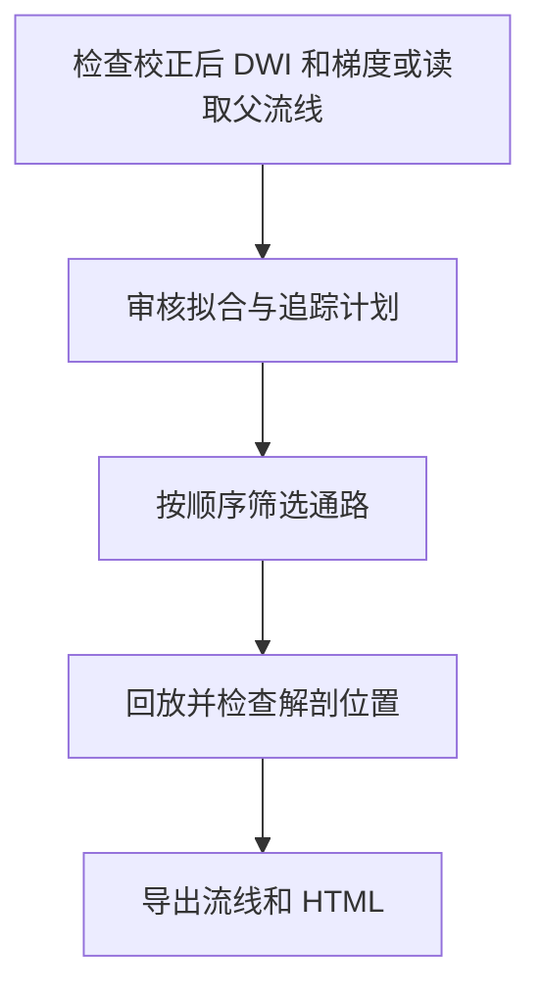

# NEO_MRI · CST/CRP 追踪

[English](README.md) · [main](https://github.com/Du-YouLang/NEO_MRI/tree/main) · [公开数据指南](https://github.com/Du-YouLang/NEO_MRI/blob/main/docs/PUBLIC_DATA.md)

增加校正后 DWI 的拟合和追踪计划、张量和单组织 CSD 分支、父流线有序筛选、回放、导出与 HTML。初次学习可使用生成的流线。

本分支保存历史功能提交 `tractography` (`e15f6cf`). 当前组合版本见 main。

## 执行流程



## 仓库结构

```text
code/               结构像和病灶命令
bold/               任务 BOLD
notebooks/          Jupyter 入口与可用教程
tractography/       追踪、筛选和报告
configs/examples/   配置模板
docs/               操作指南
tests/              合成测试
```

## 安装与数据接入

在仓库根目录用 Python 3.12 建立并激活虚拟环境，然后安装依赖。

```sh
python -m venv .venv
# POSIX: source .venv/bin/activate
# PowerShell: .venv\Scripts\Activate.ps1
python -m pip install -r requirements-lock.txt
python -m pip install --no-deps .
python -m pip install --no-deps SimpleITK==2.5.6
python -m pytest
```

输入校正后的 DWI、匹配的 bval/bvec、DWI 空间的二值门区或经独立核对的空间变换，以及可选的父流线。原生拟合和追踪依赖 MRtrix3。 配置从[示例目录](configs/examples/)复制，文件和产出放在仓库外。

```sh
python run_tractography.py demo --output /analysis/tractography_demo
python run_tractography.py report --results /analysis/tractography_demo/screened --output /analysis/tractography_demo/review.html
```

## Jupyter、教程和验证

打开[分步处理](notebooks/Tractography.ipynb)或[合成教程](notebooks/Tractography_Tutorial.ipynb)。 启动前可用 `python -m pip install jupyterlab ipywidgets` 安装 Jupyter。 [追踪指南](docs/TRACTOGRAPHY.md).

已有合成和父流线回放验证。实际跨模板映射需独立检查点位和变换方向，原生 MRtrix 追踪仍需真实环境验收。 公开人类数据可从 HCP（健康结构、扩散和运动任务）或 OpenNeuro（BIDS 任务和 ARC 卒中标注）取得，接入方式见上方数据指南。

## 致谢

- Tournier, J.-D., Smith, R., Raffelt, D., Tabbara, R., Dhollander, T., Pietsch, M., Christiaens, D., Jeurissen, B., Yeh, C.-H., & Connelly, A. (2019). MRtrix3: A fast, flexible and open software framework for medical image processing and visualisation. *NeuroImage, 202*, 116137. [DOI](https://doi.org/10.1016/j.neuroimage.2019.116137) · [MRtrix3 source](https://github.com/MRtrix3/mrtrix3)
- Mayka, M. A., Corcos, D. M., Leurgans, S. E., & Vaillancourt, D. E. (2006). Three-dimensional locations and boundaries of motor and premotor cortices as defined by functional brain imaging: A meta-analysis. *NeuroImage, 31*(4), 1453–1474. [DOI](https://doi.org/10.1016/j.neuroimage.2006.02.004) · [HMAT](https://github.com/LRNLabUF/HMAT)
- Warrington, S., Bryant, K. L., Khrapitchev, A. A., Sallet, J., Charquero-Ballester, M., Douaud, G., Jbabdi, S., Mars, R. B., & Sotiropoulos, S. N. (2020). XTRACT—Standardised protocols for automated tractography in the human and macaque brain. *NeuroImage, 217*, 116923. [DOI](https://doi.org/10.1016/j.neuroimage.2020.116923)
- Tang, Y., Sun, W., Toga, A. W., Ringman, J. M., & Shi, Y. (2018). A probabilistic atlas of human brainstem pathways based on connectome imaging data. *NeuroImage, 169*, 227–239. [DOI](https://doi.org/10.1016/j.neuroimage.2017.12.042) · [Brainstem atlas](https://www.nitrc.org/frs/download.php/10255/Brainstem23BundleAtlas.zip)

完整 APA 文献、数据和上游代码见 [致谢目录](https://github.com/Du-YouLang/NEO_MRI/blob/main/docs/ACKNOWLEDGMENTS.md)。 [NOTICE](NOTICE.md)
