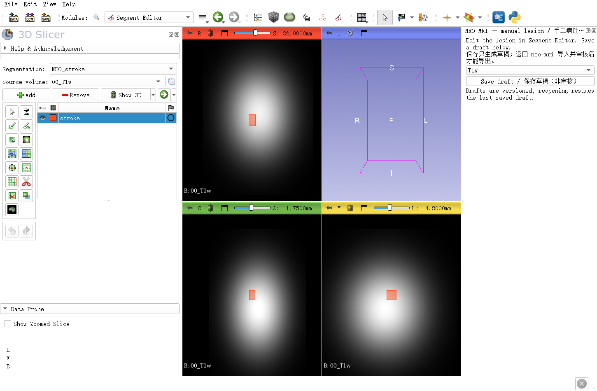

# 3D Slicer 人工病灶勾画指南

适用于本项目的 `lesion-edit` 编辑窗口，依据本地 3D Slicer 5.12.4 界面和当前桥接实现编写。先阅读本文完成窗口操作，再按[病灶接口说明](LESION.md)导入、审核和导出。

推荐第一次按顺序完成：**打开病例 → 浏览并切换背景 → 勾画与修订 → 多平面检查 → NEO 保存草稿 → 返回命令行导入 → 记录审核**。

## 1. 打开本项目的编辑窗口

先安装 Slicer，并在病灶配置的 `editor.executable` 中填入可执行文件路径。用本项目命令启动，影像与标签会自动加载：

```text
neo-mri-lesion prepare --root /analysis --config lesion.local.json
neo-mri-lesion edit --root /analysis --config lesion.local.json
```

Windows 用户应调用实际安装环境中的 `neo-mri-lesion.exe`。本文使用通用路径，不依赖某台电脑的目录。已有本地测试脚本的用户可直接使用脚本打开，无需再手工拖入影像。

窗口应进入 **Segment Editor**，出现 `NEO_stroke`（或配置的其他类型）分割，以及右侧 **NEO MRI — manual lesion / 手工病灶编辑** 面板。单独双击 Slicer 只会打开普通窗口，不会自动出现本项目面板。

首版要求 T2/FLAIR 已配准并重采样至选定 T1 网格；加载背景不会自动进行配准。同网格只说明采样几何一致，仍需人工核对解剖对应。

## 2. 认识窗口



上图来自本地合成数据验收；灰色椭球和橙色小块仅用于演示，不是患者影像或真实病灶。布局位置随窗口尺寸变化。

|位置或控件|作用|
|---|---|
|左侧 `Segment Editor`|选择当前标签及勾画工具|
|`Segmentation`|当前分割对象，通常为 `NEO_stroke`|
|`Source volume`|当前工具参考的灰度影像|
|标签列表中的 `stroke`|正在编辑的标签；先确认选中这一行|
|红、绿、黄三个切片窗|默认分别为横断、冠状、矢状视图，以实际方向标记为准|
|蓝色三维窗|辅助查看三维形态；未点击 `Show 3D` 时可能只有方向框|
|右侧背景下拉框|在 T1w、T2w、FLAIR 之间切换|
|右侧 `Save draft / 保存草稿（非审核）`|保存本模块使用的草稿快照|

**首版一个会话只编辑一个标签。** 保留已有的分割对象与标签，不点击 `Add` 新建第二个标签，也不删除后重新建立标签。卒中病灶和 WMH 分别使用独立配置与工作区。

## 3. 先学会浏览与对照

### 翻层与定位

将鼠标移到需要查看的切片窗，滚动鼠标滚轮翻层；也可拖动窗顶的切片位置滑块。切片坐标是物理位置，不能把三个窗口的滑块数字当成相同层号。

按住 `Shift` 移动鼠标，可让其他切片窗定位到同一空间位置。用它在三个方向交叉检查边界。认左右时看 `R/L`，认前后看 `A/P`，认上下看 `S/I`，不要只根据屏幕左侧推断患者左侧。[官方界面说明](https://slicer.readthedocs.io/en/latest/user_guide/user_interface.html)

### 缩放、平移和窗宽窗位

- 缩放可用 `Ctrl＋滚轮`；需要确认焦点时，在切片中轻点右键，不拖动。
- 平移或缩放后找不到影像，可使用切片窗控制条中的 `Fit to window`。
- 灰度太暗或太亮时，先退出勾画工具（`Esc`），再使用工具栏 `Adjust window/level` 调整；在切片内左键拖动改变显示。完成后重新选择勾画工具。
- 显示窗宽窗位改变的是观察方式，不会改变保存的灰度影像或标签。

这些交互会受当前鼠标模式影响；拿不准时先退出编辑工具，再操作显示。[官方显示与交互说明](https://slicer.readthedocs.io/en/latest/user_guide/user_interface.html#interacting-with-views)

### 切换 T1/T2/FLAIR

优先使用**右侧 NEO 面板的下拉框**。它会同步切换三个视图的背景，并更新 Segment Editor 的 `Source volume`；标签仍然是同一个，分割参考几何仍来自最初选定 T1。

可以在相同位置反复切换序列观察，确认标签与各背景的解剖关系。切换背景不重新分割，也不会把已画内容清空。若某序列不在配置中，下拉框不会出现它。

## 4. 使用 Paint、Draw、Erase

第一次建议只用这三个工具；先画一小块、检查、保存，熟悉流程后再处理完整范围。具体分割目标与边界定义由本次研究方案和人工判读决定。

### Paint：涂画

1. 在左侧选择 `stroke` 标签，再选择 **Paint**。
2. 在工具参数区选择合适的笔刷大小；较小的笔刷便于沿边界修订。
3. 在切片中按住左键拖动，松开鼠标应用笔画。
4. 翻到相邻层继续，同时到另外两个平面查看连续性。

首次使用先保持二维画笔，注意 `Sphere` 球形模式会影响相邻层。笔刷可以用 `Shift＋滚轮` 调整，具体效果以工具参数区显示为准。[Paint 官方说明](https://slicer.readthedocs.io/en/latest/user_guide/modules/segmenteditor.html#paint)

### Draw：沿轮廓勾画

选择 **Draw** 后，可以逐点点击或按住左键描绘轮廓，完成后按 `Enter` 应用到当前切片。应用前先确认轮廓没有跨过不打算包含的区域；必要时用 `x` 删除最后一个点。[Draw 官方说明](https://slicer.readthedocs.io/en/latest/user_guide/modules/segmenteditor.html#draw)

### Erase：擦除

选择 **Erase**，在误画区域用小笔刷擦除。修订后翻看相邻层，并在其他平面检查是否留下小突起或意外断层。不会因为擦除而更改背景影像。[Erase 官方说明](https://slicer.readthedocs.io/en/latest/user_guide/modules/segmenteditor.html#erase)

### 撤销与大范围修改

通用 Slicer 教程包含 Undo/Redo，但**当前 NEO 桥接没有主动启用撤销历史，本地验收时按钮为灰色**，不要假设 `z`、`Ctrl＋z` 能恢复误操作。少量误画用 Erase/Paint 修订；大改前先用 NEO 按钮保存一个草稿快照。

若本次误改尚未保存，可以结束这次会话、不保存本次修改，再从原入口重新打开，恢复到最近已保存草稿。这样会放弃上次保存后的所有编辑，应先确认这些改动确实不需要。

若误改已经保存，先保留全部快照。需要从较早版本继续时，可复制配置、使用新工作区，并把旧版本**已导入的标准 T1 网格掩膜**设为 `initial_mask`。只导入旧文件并不会自动让当前编辑窗口回退。不要手改收据或 `last_draft.json`。

### 其他工具的使用范围

`Fill between slices` 可按已画轮廓插值，但不根据影像识别病灶，使用后需检查每一层。先保存独立快照再尝试。`Grow from seeds` 需要至少两个标签，与本模块首版单标签会话不匹配。平滑、膨胀、去小岛等操作会改标签边界，不作为默认必做步骤。[工具说明](https://slicer.readthedocs.io/en/latest/user_guide/modules/segmenteditor.html#effects)

## 5. 保存前检查

逐层查看目标区域及其相邻层，再在另两个平面检查。临时点击标签左侧的“眼睛”隐藏/显示标签，对照下面的原始信号；隐藏只影响显示，不会删除标签。

需要三维辅助时点击 `Show 3D`，但仍以多平面切片检查为主。Slicer 标签列表中的 `Completed` 标记只属于 Slicer 的编辑状态，**不能代替本模块的 `lesion-review` 审核记录**。

对边界不确定的部分保留说明；不要仅为轮廓平滑或三维效果好看而修改。首次测试可先验证保存和导入，不必立即将完整病例标为已审核。

## 6. 保存草稿与退出

点击右侧 **`Save draft / 保存草稿（非审核）`**。成功后应看到 `Draft saved / 草稿已保存（未审核）` 及快照编号；若弹出错误，不能当作已保存。

每次保存产生独立目录，其中包含：

|文件|用途|
|---|---|
|`lesion_draft.nii.gz`|供本模块导入的标签文件|
|`lesion.seg.nrrd`|供 Slicer 保留可编辑分割信息|
|工作目录中的 `last_draft.json`|指向最后一次成功保存的草稿|

重新使用原命令打开时，默认恢复该准备版本最近一次已保存草稿，不会自动恢复未保存编辑。

**Slicer 工具栏的磁盘图标、`Ctrl＋s` 与 NEO 保存按钮用途不同。** 前两者打开 Slicer 通用数据/场景保存界面，不会更新本模块的草稿指针。正常流程优先使用右侧 NEO 按钮。

关窗时可能出现 `Save before exit?`。若已确认 NEO 草稿成功保存，且不需要额外保存整个 Slicer 场景，可选择 `Exit (discard modifications)` 退出；这会放弃没有另存的场景状态及其余未保存修改，不会删除已经写出的 NEO 草稿。若还没保存所需分割，选 `Cancel exit` 返回，再保存。[Slicer 数据与分割保存说明](https://slicer.readthedocs.io/en/latest/user_guide/modules/segmentations.html#export-segmentation-to-labelmap-volume-file)

## 7. 返回 NEO_MRI 导入与审核

保存后回到命令行：

```text
neo-mri-lesion import --root /analysis --config lesion.local.json
neo-mri-lesion status --root /analysis --config lesion.local.json
```

默认导入最近保存的 NEO 草稿。导入会核查空间与标签，并输出版本目录；打开其中 `report.html` 查看核查图。该页面只有代表切片，不能替代在 Slicer 中的全范围检查。

确认复核后，再记录审核：

```text
neo-mri-lesion review --root /analysis --config lesion.local.json --reviewer "Reviewer" --review-note "记录对照序列、复核范围、修改和不确定性"
```

空掩膜只有在确实复核后才增加 `--confirm-empty`。保存、导入、审核是三个不同步骤；状态查询与导出针对最近**已导入**版本，不会自动使用编辑器中刚保存但尚未导入的新草稿。

详细参数、外部掩膜导入和掩膜导出见[病灶接口说明](LESION.md)。本模块自动处理其自身草稿中物理采样格不变的轴翻转，不能把真正空间错位当成轴翻转忽略。

## 8. 常见问题

|现象|先检查什么|
|---|---|
|只有 Welcome，没有 NEO 面板|是否通过 `lesion-edit` 启动，而非单独打开 Slicer；同时查看启动终端错误|
|右侧面板被关闭|重新使用同一配置打开；未保存内容先按 Slicer 通用方式另存分割，不要直接丢弃|
|看不到 T2/FLAIR|配置是否包含相应的已配准背景；不要靠临时拖入影像代替输入登记|
|画了但看不到标签|是否选中正确标签、眼睛已打开、当前切片经过所画位置；在其他平面确认|
|NEO 保存报只允许一个标签|检查是否添加了第二个标签；先另存完整分割备份，避免直接删除需要的内容|
|保存后导入仍是旧结果|是否点击了 NEO 保存按钮；是否使用同一配置、工作区和准备版本；检查快照编号|
|导入提示网格不同|核对所选 T1 与外部掩膜参考空间；不能简单改 affine 或放宽阈值|
|关闭时出现保存场景提示|区分 NEO 草稿与 Slicer 场景，按第6节处理|
|状态仍为待审核|文件检查成功不会自动审核；完整复核后再执行 `lesion-review`|

## 参考与验证范围

界面示例来自本项目的合成影像验收，没有复制患者影像、临床结果或本机路径到截图。保存/恢复和物理空间往返已做合成验证；本次文档补充没有运行患者分析。

- [Slicer 用户界面与浏览操作](https://slicer.readthedocs.io/en/latest/user_guide/user_interface.html)
- [Segment Editor 工具](https://slicer.readthedocs.io/en/latest/user_guide/modules/segmenteditor.html)
- [Segmentations 导入与导出](https://slicer.readthedocs.io/en/latest/user_guide/modules/segmentations.html)

操作正确不等于病灶边界已获得临床确认；多序列解剖复核和分割目标仍由使用者负责。
